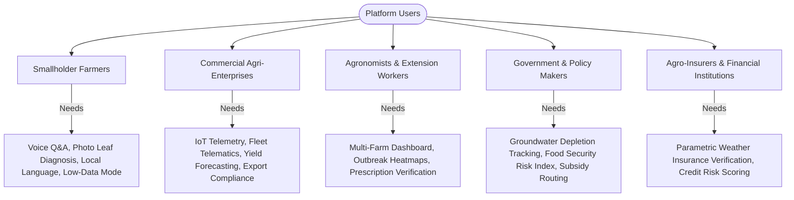
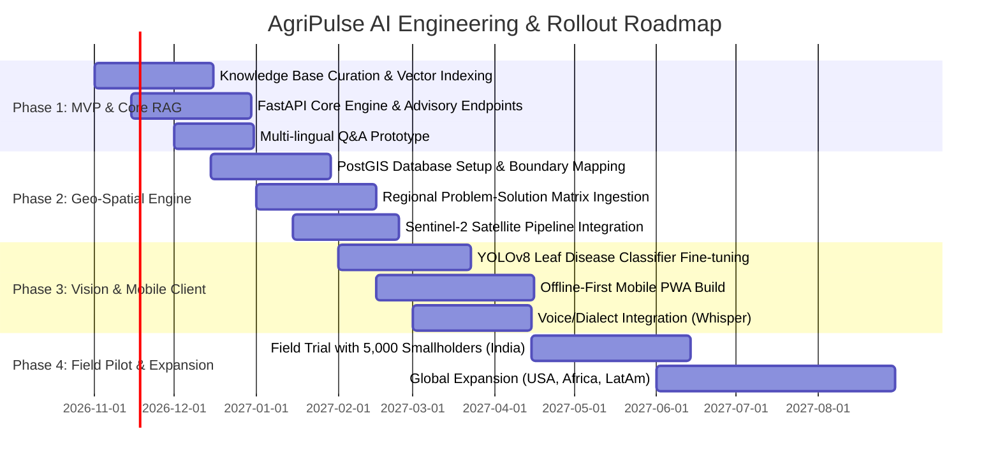

# AgriPulse AI: Global Agriculture Intelligence & Advisory Platform
## Comprehensive Industry Case Study

---

### Executive Summary

Agriculture sustains over 8 billion people and employs more than 1.2 billion workers globally. However, modern agriculture faces a triple convergence crisis:
1. **Climate Volatility**: Unpredictable precipitation, heat domes, desertification, and novel pest migrations.
2. **Resource Scarcity**: Severe groundwater depletion (e.g., Indo-Gangetic Plain, California Central Valley, Ogallala Aquifer) and soil degradation.
3. **Information Asymmetry**: Smallholder and commercial farmers alike lack real-time, hyper-localized agronomic guidance tailored to their exact coordinates, soil profile, and regional micro-climates.

**AgriPulse AI** is an intelligent, geo-aware agricultural advisory platform engineered to bridge the knowledge-action gap. By combining multi-modal Large Language Models (LLMs), satellite remote sensing (NDVI/soil moisture), geospatial vulnerability indexing, and localized agronomic knowledge bases, AgriPulse AI delivers end-to-end advisory—from diagnosing leaf blight within seconds to providing macro-level mitigation strategies for drought-stricken states and nations.

---

### Key Highlights & Projected Impact

| Metric | Target Outcome | Validation Basis |
| :--- | :--- | :--- |
| **Input Cost Reduction** | **22% - 35%** | Precision fertilizer (NPK) application & targeted bio-pesticide scheduling |
| **Average Crop Yield Increase** | **18% - 28%** | Real-time disease detection & evapotranspiration (ET)-based irrigation |
| **Water Conservation** | **30% - 45%** | IoT soil sensor integration + micro-drip scheduling algorithms |
| **Advisory Latency** | **< 3 seconds** | Edge-cached AI models and localized retrieval-augmented generation (RAG) |
| **Regional Coverage** | **Global / Multi-Tier** | Country $\to$ State $\to$ Agro-Climatic Zone $\to$ Field-level resolution |

---

## 1. Problem Statement & Market Analysis

### 1.1 The Global Agricultural Knowledge Gap
Agriculture is inherently hyper-local. A treatment protocol that works for black cotton soil in Maharashtra, India, will devastate sandy loam crops in Rajasthan or alluvial silt in Punjab. Furthermore, smallholder farmers—who produce over 30% of the world's food on farms smaller than 2 hectares—suffer from:
- **Low Extension Officer Ratio**: In developing regions, extension worker ratios often exceed 1:2,500 farmers (against FAO recommended 1:400).
- **Counterfeit Agro-Chemicals**: Up to 25% of fertilizers and pesticides sold in emerging markets are substandard or counterfeit, resulting in soil toxicity and crop loss.
- **Delayed Intervention**: Pests such as Fall Armyworm (*Spodoptera frugiperda*) or Desert Locusts multiply exponentially; a 48-hour delay in diagnosis can result in 70%+ crop loss.

### 1.2 Regional Discrepancies & Systemic Vulnerabilities
- **Sub-Saharan Africa (e.g., Kenya, Nigeria)**: Fragmented supply chains, lack of localized soil testing, post-harvest losses exceeding 40% due to cold storage deficits.
- **South Asia (e.g., India, Pakistan, Bangladesh)**: Severe groundwater over-extraction, nutrient imbalance (overuse of subsidized Urea/Nitrogen causing soil acidification), and stubble burning air-quality crises.
- **North America (e.g., California, Midwest Corn Belt)**: Severe drought cycles, agricultural runoff causing marine dead zones (Gulf of Mexico hypoxia), and labor shortages.
- **Europe (e.g., Netherlands, Spain, France)**: Stringent EU Green Deal regulations, nitrogen emission caps, and chronic summer droughts in the Mediterranean basin.

---

## 2. Target Audience & Stakeholder Personas



### 2.1 Persona Breakdown

1. **Ramesh Patel (Smallholder Farmer - 1.8 Hectares, Gujarat, India)**
   - *Challenges*: Limited literacy, speaks Gujarati, relies on local input dealer advice (often biased towards expensive pesticides).
   - *Platform Need*: Voice-based Q&A in regional dialect, camera-based leaf disease diagnosis, Mandi (market) price comparison within a 50 km radius.

2. **Elena Vasquez (Agronomist & Cooperative Manager - Almería, Spain)**
   - *Challenges*: Stricter EU chemical restrictions, water quotas for greenhouse horticulture.
   - *Platform Need*: Precision irrigation scheduling based on VPD (Vapor Pressure Deficit), biological pest control recommendations (e.g., predatory mites).

3. **David Miller (Large-Scale Grain Producer - 1,200 Acres, Iowa, USA)**
   - *Challenges*: Soil erosion, high fertilizer costs, precision variable rate seeding.
   - *Platform Need*: Multi-spectral satellite NDVI analytics, cover crop management, carbon credit audit trails.

4. **Kiprono Koech (Extension Officer - Nakuru County, Kenya)**
   - *Challenges*: Covers 18 villages across rough terrain with intermittent 3G connectivity.
   - *Platform Need*: Offline-first mobile app that synchronizes diagnoses and alerts farmers to regional pest swarms via USSD/SMS gateway.

---

## 3. Product Architecture & Core Features

AgriPulse AI is structured around four interconnected engines:

```
+-----------------------------------------------------------------------------------+
|                              AGRIPULSE AI PLATFORM                                |
+-----------------------------------------------------------------------------------+
|  1. Universal Agri Q&A        2. Geo-Spatial Problem      3. Computer Vision      |
|     Advisory Engine              Resolution Matrix           Disease Doctor       |
|  - Multi-lingual RAG          - Country/State/Zone Index  - Leaf symptom parser   |
|  - Domain Knowledge Graph     - Root cause diagnostics    - Multi-pest detection  |
|  - Voice & Dialect NLP        - Algorithmic interventions - Bio & chemical RX     |
+-----------------------------------------------------------------------------------+
|                     4. Precision Data & External Connectors                       |
|  - Satellite (Sentinel-2/Landsat) - IoT Soil & Weather - Mandi/Commodity Prices   |
+-----------------------------------------------------------------------------------+
|                         Scalable Cloud Infrastructure                             |
|       FastAPI Backend | PostGIS Geospatial DB | Qdrant Vector | Redis             |
+-----------------------------------------------------------------------------------+
```

### 3.1 Pillar 1: Universal Agricultural Q&A Advisory Engine
The Q&A engine accepts user inquiries across all farming domains:
- **Soil & Nutrient Management**: Interprets soil test reports (pH, Electrical Conductivity, N-P-K, Organic Carbon, Micro-nutrients) and outputs precise fertilizer scheduling.
- **Crop Protection & Entomology**: Identifies fungal, bacterial, viral, and insect threats; prioritizes Integrated Pest Management (IPM), bio-control agents, and targeted chemical regimens.
- **Irrigation & Water Budgeting**: Dynamic watering schedules calculated using Penman-Monteith reference evapotranspiration ($ET_0$) factored against soil type and crop growth stage ($K_c$).
- **Market Intelligence**: Advises when to harvest and sell by analyzing historical seasonal price fluctuations across local, regional, and national wholesale markets.

### 3.2 Pillar 2: Geo-Spatial Problem Resolution Engine
A hierarchical knowledge and policy engine structured into:
$$\text{Country} \longrightarrow \text{State / Province} \longrightarrow \text{Agro-Climatic Zone} \longrightarrow \text{District / Field}$$
For each layer, the system maintains:
1. **Critical Stress Indicators**: Drought indices (SPI, SPEI), groundwater table decline rates, soil salinity profiles ($dS/m$), and pest infestation probability.
2. **Actionable Interventions**:
   - **Immediate Farmer Actions**: Specific cultural and chemical interventions.
   - **Infrastructure Interventions**: Farm ponds, laser land leveling, solar micro-irrigation, cold chain hubs.
   - **Policy & Government Subsidies**: Alignment with active governmental assistance programs (e.g., PM-KUSUM in India, USDA EQIP in the US, EU CAP subsidies).

### 3.3 Pillar 3: Computer Vision "Crop Doctor"
- Farmers capture photos of damaged foliage, stems, or fruits.
- A convolutional backbone (YOLOv8 + Vision Transformer) identifies disease class, severity rating (percentage of leaf area infected), and confidence score.
- The diagnosis instantly triggers the advisory engine to provide verified treatment steps.

### 3.4 Pillar 4: Offline-First & Voice-First Interface
- To bridge the rural digital divide, AgriPulse includes an offline local vector cache for common crops and diseases.
- Supports Whisper ASR (Automatic Speech Recognition) fine-tuned on regional farming vocabulary, coupled with localized Text-to-Speech (TTS).

---

## 4. Technical Feasibility & System Engineering

### 4.1 Tech Stack Specification

| Component | Technology | Rationale |
| :--- | :--- | :--- |
| **Frontend Web & PWA** | Next.js 14 / React / TailwindCSS | High performance, server-side rendering for SEO, PWA offline caching |
| **Mobile Client** | Flutter / React Native | Cross-platform (Android/iOS) with native camera and Bluetooth IoT sensor access |
| **API Gateway & Services** | FastAPI (Python 3.11+) | Async high throughput, native integration with PyTorch/TensorFlow & LangChain |
| **Geospatial Database** | PostgreSQL 16 + PostGIS | Spatial polygon queries (`ST_Contains`, `ST_DWithin`) for field boundaries |
| **Vector Database (RAG)**| Qdrant / pgvector | Hybrid vector + metadata filtering (querying agronomic papers by crop + zone) |
| **LLM & Vision Models** | Gemini 1.5 Pro / Flash + YOLOv8 | Multimodal image understanding, 1M+ context window for full agronomic textbooks |
| **Satellite Pipeline** | Google Earth Engine API / Sentinel-Hub | Real-time NDVI, NDRE, NDWI calculation on a 5-day revisit cycle |
| **Cache & Task Queue** | Redis + Celery | Rate limiting, async image processing, caching live weather & Mandi data |

### 4.2 Data Ingestion & Knowledge Graph Architecture
AgriPulse is pre-indexed with:
- Peer-reviewed research from **FAO** (Food and Agriculture Organization), **ICAR** (Indian Council of Agricultural Research), **CGIAR** institutes (IRRI, CIMMYT, ICRISAT), and **USDA ARS**.
- Standardized chemical safety guidelines (WHO pesticide toxicity classes, maximum residue limits - MRLs).
- Live real-time APIs: Open-Meteo / NOAA for hyper-local 15-day weather and evapotranspiration data; Agmarknet / USDA AMS for commodity prices.

---

## 5. Implementation Roadmap & Milestones



---

## 6. Business Model & Financial Sustainability

AgriPulse AI operates a balanced B2C/B2B/B2G hybrid model designed for both social impact and financial viability:

1. **Farmer Freemium (B2C)**:
   - Free: Basic voice/text Q&A, weather forecasts, market prices, up to 10 leaf scans/month.
   - AgriPulse Pro (\$2-\$5/month): Unlimited disease scans, customized fertilization calendars, IoT sensor connectivity, satellite crop health reports.

2. **Enterprise & Agri-Input Dealers (B2B SaaS)**:
   - Agri-chemical and seed corporations pay for authenticated dealer dashboards to dispense certified products, monitor regional disease heatmaps, and target inventory.
   - Agricultural insurance companies use satellite yield verification to process parametric insurance payouts in hours rather than months.

3. **Government & NGO Partnerships (B2G)**:
   - Subsidized deployment contracts with state agricultural departments to amplify extension worker efficiency and monitor district-level water stress.

---

## 7. Risk Analysis & Mitigation Framework

| Risk Factor | Probability | Impact | Mitigation Strategy |
| :--- | :--- | :--- | :--- |
| **Hallucinated Chemical Prescriptions** | Medium | Critical | Hard guardrails: All chemical dosage suggestions are filtered against an approved government pesticide register before delivery. |
| **Low Rural Internet Connectivity** | High | High | Offline-first SQLite/IndexedDB vector storage; SMS/USSD fallback engine for remote locations. |
| **User Mistrust of AI Guidance** | Medium | High | "Human-in-the-Loop" extension verification; citations from local agricultural universities attached to every recommendation. |
| **Varied Regional Dialects** | High | Medium | Speech pipeline with acoustic fine-tuning on regional agrarian vernaculars and slang. |

---

## 8. Conclusion

AgriPulse AI transforms agriculture from a reactive, guessing-based gamble into a data-driven, predictive, and resilient science. By placing hyper-localized, expert-grade agronomic guidance directly into the hands of farmers worldwide and equipping policymakers with real-time geospatial problem-solving intelligence, the platform addresses immediate crop dilemmas while safeguarding long-term global food security.
