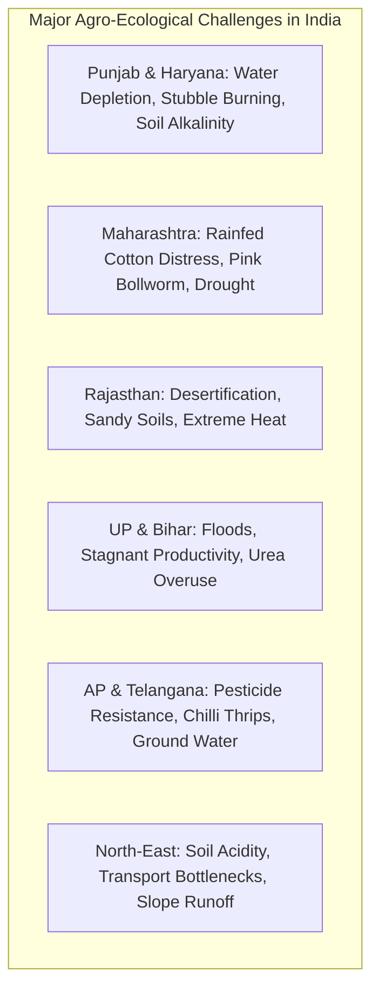
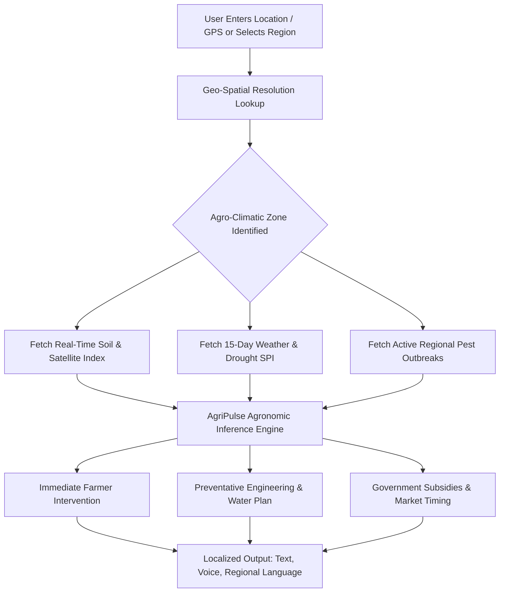

# Global Geo-Agricultural Intelligence: Problems, Root Causes & Actionable Solutions
## Regional, State & National Agronomic Vulnerability Matrix

This document provides a comprehensive operational breakdown of agricultural crises, structural vulnerabilities, and multi-tiered solutions across major global agricultural geographies. It serves as the core domain knowledge base for the **AgriPulse AI** platform.

---

## Matrix Navigation Index
1. [India: Multi-State Agronomic Breakdown](#1-india-multi-state-agronomic-breakdown)
   - [1.1 Punjab & Haryana (North Zone)](#11-punjab--haryana-north-zone)
   - [1.2 Maharashtra - Vidarbha & Marathwada (West-Central Zone)](#12-maharashtra---vidarbha--marathwada)
   - [1.3 Rajasthan (Arid Northwest Zone)](#13-rajasthan-arid-northwest-zone)
   - [1.4 Uttar Pradesh & Bihar (Indo-Gangetic Plain)](#14-uttar-pradesh--bihar-indo-gangetic-plain)
   - [1.5 Andhra Pradesh & Telangana (Deccan Plateau)](#15-andhra-pradesh--telangana)
   - [1.6 Kerala & Coastal Western Ghats](#16-kerala--coastal-western-ghats)
   - [1.7 Assam & North-East Hill States](#17-assam--north-east-hill-states)
2. [United States: Key Agricultural Belts](#2-united-states-key-agricultural-belts)
   - [2.1 California Central Valley (West Coast)](#21-california-central-valley)
   - [2.2 Midwest Corn Belt (Iowa, Illinois, Indiana)](#22-midwest-corn-belt)
   - [2.3 High Plains / Ogallala Region (Kansas, Nebraska, Texas)](#23-high-plains--ogallala-region)
   - [2.4 Florida Citrus Belt](#24-florida-citrus-belt)
3. [Sub-Saharan Africa](#3-sub-saharan-africa)
   - [3.1 Kenya (Rift Valley & Arid Lands)](#31-kenya-rift-valley--arid-lands)
   - [3.2 Nigeria (Sahel & Middle Belt)](#32-nigeria-sahel--middle-belt)
   - [3.3 Ethiopia (Highlands & Lowland Pastures)](#33-ethiopia-highlands--lowland-pastures)
4. [Europe](#4-europe)
   - [4.1 Netherlands (High-Tech Lowlands)](#41-netherlands-high-tech-lowlands)
   - [4.2 Spain - Andalusia & Almería (Mediterranean)](#42-spain---andalusia--almería)
5. [Latin America](#5-latin-america)
   - [5.1 Brazil - Cerrado & Mato Grosso](#51-brazil---cerrado--mato-grosso)
6. [Southeast Asia & Oceania](#6-southeast-asia--oceania)
   - [6.1 Vietnam - Mekong River Delta](#61-vietnam---mekong-river-delta)
   - [6.2 Australia - Murray-Darling Basin](#62-australia---murray-darling-basin)

---

## 1. India: Multi-State Agronomic Breakdown

### 1.1 Punjab & Haryana (North Zone)

#### Critical Problems
1. **Severe Groundwater Depletion**: Water tables sinking at 0.5 to 1.0 meter annually due to flood-irrigated paddy-wheat monoculture driven by free agricultural electricity.
2. **Crop Residue (Stubble) Burning**: 20+ million tons of paddy straw burned annually in October-November, generating massive air pollution across Northern India.
3. **Soil Micronutrient Depletion & Salinization**: Excessive reliance on subsidised Urea ($46\% \text{ N}$) has caused N:P:K ratios to distort to $31:8:1$ (ideal is $4:2:1$), alongside secondary zinc and iron deficiencies.

#### How AgriPulse AI Solves It
- **Agronomic Intervention**:
  - Transition from conventional transplanted paddy to **Direct Seeded Rice (DSR)**, reducing water consumption by $30\%$ and electricity usage by $25\%$.
  - Promote short-duration rice varieties (e.g., PR-126) maturing in 120 days, providing a 25-day buffer before wheat sowing to eliminate the stubble-burning rush.
  - Introduce **Happy Seeder** and **Super SMS** attached combine harvesters that chop and mulch straw directly into wheat seedbeds as organic mulch.
- **Tech Stack & IoT**:
  - Satellite thermal infrared monitoring (Sentinel-3) to detect field burning in real time and alert village panchayats.
  - Soil Tensiometers and automated canal discharge alerts integrated into the AgriPulse mobile app.
- **Policy & Subsidy Integration**:
  - Connect farmers to PM-PRANAM scheme (restoration of mother earth through balanced fertilization) and state in-situ crop residue management machinery subsidies (50-80% rebate).

---

### 1.2 Maharashtra - Vidarbha & Marathwada

#### Critical Problems
1. **Acute Drought & Unpredictable Monsoons**: Over $82\%$ of farmland is purely rainfed; recurrent dry spells during flowering cause catastrophic cotton and soybean abortion.
2. **Pink Bollworm (*Pectinophora gossypiella*) Resistance**: Pink bollworm has developed severe resistance to transgenic Bt-cotton (Cry1Ac and Cry2Ab toxins).
3. **Smallholder Indebtedness & Monocropping**: High input costs for unauthorized hybrid seeds and cocktail sprays coupled with dry spells lead to chronic distress.

#### How AgriPulse AI Solves It
- **Agronomic Intervention**:
  - Deploy **High-Density Planting System (HDPS)** with non-Bt / native compact cotton varieties (e.g., Suraj, PKV-081) that finish within 150 days before the bollworm population peaks.
  - Pheromone trap grid deployment ($5$ traps per acre) with automated AgriPulse trap counts to trigger mass-mating disruption using PB-Rope dispensers.
- **Tech Stack & Water Engineering**:
  - Precision Farm Pond construction (Jalyukt Shivar model) with geotextile lining to prevent percolation.
  - AgriPulse AI weather forecasting module delivers 10-day probabilistic rainfall alerts so farmers avoid applying costly fertilizers right before rain washouts.
- **Financial & Market Linkages**:
  - Parametric crop insurance triggered automatically by local automated weather stations (AWS) data, eliminating delay in claim payouts.

---

### 1.3 Rajasthan (Arid Northwest Zone)

#### Critical Problems
1. **Hyper-Aridity & Sand Dune Encroachment**: Annual rainfall under $250\text{ mm}$ in western districts (Jaisalmer, Barmer, Bikaner).
2. **Low Soil Water Holding Capacity**: Coarse sandy soils with organic carbon content below $0.15\%$.
3. **High Evapotranspiration Rate**: Daily evaporation rates exceeding $8\text{--}12\text{ mm/day}$ in summer.

#### How AgriPulse AI Solves It
- **Agronomic Intervention**:
  - Promote high-value arid and semi-arid horticulture: **Date Palm (Tissue Culture), Pomegranate (Bhagwa), Ber, and Jojoba**.
  - Intercropping Pearl Millet (Bajra) with drought-hardy legumes (Cluster Bean / Guar and Moth Bean) for biological nitrogen fixation.
- **Technological Solution**:
  - Solar-powered micro-drip irrigation systems linked to subsurface porous pipes, placing water directly at the root zone (saving $65\%$ water over flood irrigation).
  - Hydrogel soil amendments that absorb 400 times their weight in water, releasing moisture during dry spells.
- **Policy Alignment**:
  - Integration with the **PM-KUSUM** scheme to install subsidized off-grid solar irrigation pumps.

---

### 1.4 Uttar Pradesh & Bihar (Indo-Gangetic Plain)

#### Critical Problems
1. **Monsoon Flooding & Waterlogging**: Eastern UP and North Bihar (Kosi basin) experience annual inundation, submerging standing crops for 15-30 days.
2. **Extreme Land Fragmentation**: Average landholding is under $0.6$ hectares, limiting mechanization.
3. **Severe Post-Harvest Wastage**: Up to $35\%$ of perishable vegetables (potato, tomato, mango) rot due to localized cold chain deficits.

#### How AgriPulse AI Solves It
- **Agronomic Intervention**:
  - Introduce **Submergence-Tolerant Rice (Sub1 varieties)** such as *Swarna-Sub1* and *Bina-Dhan 11*, which survive complete underwater immersion for up to 14 days without yield penalty.
  - Post-flood zero-tillage relay cropping of mustard, chickpea, and lentil into wet silt before soil crusts harden.
- **Technological Solution**:
  - AgriPulse Group-Farming Mode: Aggregates input orders and machinery rentals (Custom Hiring Centers - CHCs) for smallholders to achieve bulk discounts.
  - Micro cold-storage hubs powered by decentralized solar-biomass hybrid systems with capacity tracking on the AgriPulse platform.

---

### 1.5 Andhra Pradesh & Telangana

#### Critical Problems
1. **Invasive Pest Infestations**: Black Thrips (*Thrips parvispinus*) outbreak on chilli crops, causing up to $80\%$ flower drop and leaf curl.
2. **Over-reliance on Chemical Cocktails**: Indiscriminate tank-mixing of 4-5 chemical insecticides, wiping out natural predators (spiders, predatory mites, lacewings).

#### How AgriPulse AI Solves It
- **Agronomic & Bio-Control**:
  - Mandatory blue sticky traps (30-40 per acre) positioned at canopy height.
  - Spraying bio-insecticides like *Beauveria bassiana* and *Verticillium lecanii* ($5\text{ g/L}$) during early evening hours to ensure fungus survival against UV radiation.
- **AI Diagnostics**:
  - AgriPulse Leaf Scanner identifies Thrips nymph vs. adult mites under $10\times$ optical zoom on smartphone cameras and issues immediate non-chemical intervention sequences.

---

### 1.6 Kerala & Coastal Western Ghats

#### Critical Problems
1. **High Soil Acidity ($\text{pH } 4.2 - 5.2$)**: Aluminum and iron toxicity locking up phosphorus; calcium and magnesium deficiencies.
2. **Fungal Blights in Plantations**: Quick wilt of black pepper (*Phytophthora capsici*), abnormal leaf fall of rubber, and bud rot in coconut during high-humidity South-West monsoon.

#### How AgriPulse AI Solves It
- **Agronomic Intervention**:
  - Precise soil liming with agricultural dolomite ($250\text{--}500\text{ kg/ha}$) 15 days before main fertilizer application to elevate pH to $6.0\text{--}6.5$.
  - Biocontrol consortium: Soil drenching and root coating with *Trichoderma harzianum* and *Pseudomonas fluorescens*.
- **Tech Stack**:
  - Humidity-based fungal spore germination predictive models triggering preventative copper oxychloride or bio-fungicide sprays before visual symptoms emerge.

---

### 1.7 Assam & North-East Hill States

#### Critical Problems
1. **Slope Soil Erosion & Jhum (Shifting) Cultivation**: Topsoil wash-off during heavy monsoon rains ($>2,500\text{ mm}$ annually).
2. **Logistical Isolation**: Inability to transport high-value organic produce (Bhut Jolokia, Karbi Anglong ginger, Lakadong turmeric) to mainland markets before spoilage.

#### How AgriPulse AI Solves It
- **Agronomic Intervention**:
  - Contour bunding and **Sloping Agricultural Land Technology (SALT)** using nitrogen-fixing hedgerows (*Flemingia macrophylla*).
  - Maximizing organic curcumin production via Lakadong turmeric ($7.5\%\text{+}$ curcumin content) under organic certification.
- **Logistical / Tech Solution**:
  - Digital GI (Geographical Indication) tagging and direct-to-buyer traceability on the AgriPulse marketplace, bypassing exploitative middlemen.

---

## 2. United States: Key Agricultural Belts

### 2.1 California Central Valley

#### Critical Problems
1. **Severe Multi-Year Drought & SGMA Mandates**: The Sustainable Groundwater Management Act (SGMA) mandates a $20\text{--}30\%$ cut in groundwater pumping by 2040, threatening to fallow over 500,000 acres.
2. **Root-Zone Salinization**: High evaporation rates leave dissolved salts in topsoil, stunting almond, pistachio, and grape yields.
3. **Agricultural Labor Shortage**: Escalating wage costs and seasonal harvest worker deficits.

#### How AgriPulse AI Solves It
- **Technology & Engineering**:
  - **OpenET Satellite Integration**: Daily field-level evapotranspiration monitoring via Landsat/MODIS to calibrate drip irrigation to exact crop water demand ($ET_c = ET_0 \times K_c$).
  - **Managed Aquifer Recharge (Ag-MAR)**: Diverting winter atmospheric river floodwaters onto dormant alfalfa and almond orchards to recharge depleted underground aquifers.
  - Automated autonomous weeding rovers and drone-based targeted spraying.

---

### 2.2 Midwest Corn Belt (Iowa, Illinois, Indiana)

#### Critical Problems
1. **Topsoil Loss & Compaction**: Over-tillage leading to soil loss at 5 tons/acre/year.
2. **Nitrate & Phosphorus Runoff**: Excessive spring broadcast fertilization leaches into the Mississippi River basin, causing the Gulf of Mexico Hypoxic "Dead Zone".
3. **Superweed Resistance**: Glyphosate and dicamba-resistant Palmer amaranth and waterhemp.

#### How AgriPulse AI Solves It
- **Regenerative Precision Agriculture**:
  - Integration of multi-species winter cover crops (cereal rye, hairy vetch) to sequester nitrogen and prevent winter erosion.
  - Variable Rate Technology (VRT): Prescriptive tractor maps generated by AgriPulse AI that adjust nitrogen injection in real time based on soil electrical conductivity (EC) sensors.
  - Edge-of-field saturated buffers and woodchip bioreactors that denitrify tile drain water before it enters waterways.

---

### 2.3 High Plains / Ogallala Region (Kansas, Nebraska, Texas)

#### Critical Problems
- **Exhaustion of the Ogallala Fossil Aquifer**: Fossil water extracted at 6-10 times the natural recharge rate; once depleted, recharge takes over 6,000 years.

#### How AgriPulse AI Solves It
- Crop-switching algorithm: Transitioning acres from thirsty feed corn ($650\text{--}800\text{ mm}$ water requirement) to grain sorghum and drought-tolerant sunflower ($400\text{--}450\text{ mm}$), supported by low-elevation spray application (LESA) pivot irrigation.

---

### 2.4 Florida Citrus Belt

#### Critical Problems
- **Citrus Greening (Huanglongbing - HLB)**: Bacterial disease vectored by the Asian citrus psyllid (*Diaphorina citri*), reducing Florida orange production by over $75\%$ over two decades.

#### How AgriPulse AI Solves It
- Early acoustic sensor detection of psyllid wing-beat frequencies combined with trunk injection of oxytetracycline and deployment of Individual Protective Covers (IPCs) on young saplings.

---

## 3. Sub-Saharan Africa

### 3.1 Kenya (Rift Valley & Arid Lands)

#### Critical Problems
1. **Fall Armyworm (*Spodoptera frugiperda*)**: Decimating smallholder maize yields by $30\text{--}50\%$.
2. **Lack of Cold Storage**: Post-harvest loss of up to $45\%$ of mango and horticultural crops.
3. **Intermittent Internet / Low Literacy**: Farmers cannot access modern web portals.

#### How AgriPulse AI Solves It
- **USSD / SMS / Voice AI Gateway**: Accessible on \$15 2G feature phones via `*384#` shortcode in Swahili and Kikuyu.
- **ColdHubs Integration**: Decentralized, solar-powered walk-in cold rooms located at market centers, rented for \$0.50 per crate/day.
- **Push-Pull Technology**: Intercropping maize with Silverleaf Desmodium (which repels moths) and planting Napier grass on field borders (which attracts and traps them).

---

### 3.2 Nigeria (Sahel & Middle Belt)

#### Critical Problems
- **Sahel Desertification & Cattle-Farmer Conflict**: Encroaching Sahara pushes pastoralists southward into crop zones; extreme tomato spoilage during transit from Kano to Lagos.

#### How AgriPulse AI Solves It
- Solar-powered tomato paste micro-processing units installed at harvest points.
- Satellite-mapped designated grazing corridors with water-point GPS markers to prevent crop encroachment.

---

## 4. Europe

### 4.1 Netherlands (High-Tech Lowlands)

#### Critical Problems
- **Nitrogen Crisis (Stikstofcrisis)**: Strict EU Natura 2000 limits on ammonia emissions from livestock and dairy, resulting in government-mandated herd reductions.

#### How AgriPulse AI Solves It
- Circular closed-loop agriculture: Automated barn floor separators dividing animal urine from feces to stop ammonia gas formation.
- High-efficiency aeroponic and hydroponic vertical farms utilizing waste industrial heat and $95\%$ recirculated water.

---

### 4.2 Spain - Andalusia & Almería

#### Critical Problems
- **The "Plastic Sea" Water Deficit**: Massive greenhouse cluster in Almería pumping saline coastal groundwater; intense summer heat stress.

#### How AgriPulse AI Solves It
- Reverse osmosis seawater desalination coupled with closed-loop drainage recycling.
- Evaporative cooling pad automation managed via AgriPulse VPD (Vapor Pressure Deficit) algorithms.

---

## 5. Latin America

### 5.1 Brazil - Cerrado & Mato Grosso

#### Critical Problems
1. **Soybean Asian Rust (*Phakopsora pachyrhizi*)**: Can defoliate an entire soybean field in 10-14 days.
2. **Extreme Soil Phosphorus Fixation**: Highly weathered, acidic oxisols lock up applied phosphorus.

#### How AgriPulse AI Solves It
- **Integrated Crop-Livestock-Forestry (ICLF)**: Rotational grazing with deep-rooted *Brachiaria* grasses that bring deep subsoil phosphorus to the surface and build organic matter.
- Real-time satellite rust spore trajectory modeling using atmospheric wind data to alert farms 7 days before regional arrival.

---

## 6. Southeast Asia & Oceania

### 6.1 Vietnam - Mekong River Delta

#### Critical Problems
- **Saltwater Intrusion & Upstream Damming**: Sea water moving up to 60-90 km inland during the dry season, destroying freshwater rice paddies.

#### How AgriPulse AI Solves It
- **Rice-Shrimp Rotational Farming**: Growing salt-tolerant rice during the freshwater wet season, and culturing black tiger shrimp in brackish water during the dry season.
- Alternate Wetting and Drying (AWD) water management, reducing methane emissions by $40\%$ and saving $25\%$ fresh water.

---

### 6.2 Australia - Murray-Darling Basin

#### Critical Problems
- Severe river basin over-allocation, periodic fish kills, and extreme evaporation loss from open irrigation channels.

#### How AgriPulse AI Solves It
- Solar panel canal covers (reducing evaporation by $80\%$ while generating green power) and automated canal sluice gate telemetry using AgriPulse flow balance algorithms.

---

## 7. Comparative Summary Matrix

| Country / Region | Primary Agronomic Threat | Root Cause | AgriPulse Core Solution | Primary Metric of Success |
| :--- | :--- | :--- | :--- | :--- |
| **India (Punjab)** | Groundwater collapse | Free power, flood rice | DSR + Happy Seeder mulching | 30% water saved, 0 fires |
| **India (Maharashtra)**| Rainfed cotton failure | Pink bollworm resistance | HDPS + Pheromone mating disruption | 40% pesticide cut, stable yield |
| **India (Rajasthan)** | Arid sand dunes | Extreme evaporation | Solar drip + Arid horticulture | 3x farmer income per acre |
| **India (Kerala)** | Soil acidity & fungal rot | Heavy monsoon, pH < 5.0 | Dolomite + *Trichoderma* biocontrol | 85% root rot prevention |
| **USA (California)** | Water allocation caps | SGMA limits, drought | Satellite OpenET + Ag-MAR recharge | 25% water compliance |
| **USA (Midwest)** | Gulf hypoxia / Runoff | Bare soil in winter | Cover crops + Variable Rate N | 40% nitrate reduction |
| **Kenya (Rift Valley)**| Fall armyworm & tech gap | Low 4G access, fast pest | USSD Voice AI + Push-Pull planting | 50% yield saved on 2G phones |
| **Vietnam (Mekong)** | Saltwater intrusion | Sea level & dams | Rice-Shrimp rotational ecosystem | 2.2x income diversification |

---

## 8. Algorithmic Implementation Flowchart

